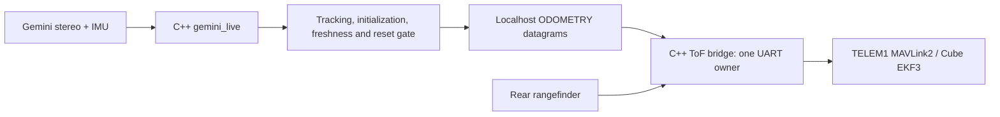

> **Project end goal:** Build a drone that autonomously flies a guided mission without GPS while detecting and avoiding obstacles along the way.
> This integration provides the localization interface needed for GPS-denied control. See the [shared project goal](../PROJECT_GOAL.md).

# Gemini VIO to Cube Orange+

Current VINS observation mounting update (2026-11-18): 22.8 degrees down, 0.13 m forward and 0.05 m below the Cube, as reported by the operator. This supersedes the older 0.15 m upright assumption below for the VINS boot profile. See [current mount and forwarding contract](vins-observation-forwarding.md).

Current VINS-Fusion update (2026-10-28): producer gate is 0.5 s / 40 features;
the Fusion relay profile and Cube `VISO_QUAL_MIN` are aligned to 40. See
[quality alignment validation](../reports/fusion-downstream-align-20261028/review.md).
The dated inspection tables below retain their historical values.

Update: the [headless Cube test](cube-vio-test.md) now uses a separate native
USB bridge and the Cube buzzer. Its configuration was applied and verified
after reboot; see `reports/cube-vio-config-applied/` and
`reports/cube-vio-post-reboot.json`. The inspection and proposal sections below
describe the earlier baseline. Primary navigation settings remain unchanged;
secondary external-navigation fusion has not been selected or validated.

The native C++17 bench path captures stereo and IMU, runs ORB-SLAM3, converts
eligible camera poses to vehicle navigation coordinates, and can publish MAVLink2
`ODOMETRY` through the existing ToF UART bridge. All new runtime and validation
code is C++; Python is not part of this path. Flight-controller parameters have
not been changed and external-navigation fusion is not yet validated.



## Existing configuration and live inspection

The other integration's authoritative local records are
[`tools/tof_bridge/README.md`](../tools/tof_bridge/README.md) and
[`reports/tof/cube-rear-rangefinder-03/`](../reports/tof/cube-rear-rangefinder-03/).
Earlier TELEM2/115200 and proximity examples are historical, not the present setup.

The read-only inspection on 2026-10-24 confirmed:

| Item | Read back |
|---|---|
| Firmware | ArduCopter 4.7.1, hash `dbe79216` |
| Vehicle | System 1/component 1; disarmed |
| Companion link | `/dev/ttyTHS1`, 57600 baud, TELEM1 |
| Protocol | `SERIAL1_PROTOCOL=2`, `SERIAL1_BAUD=57` |
| EKF | `AHRS_EKF_TYPE=3`, `EK3_ENABLE=1` |
| Source set 1 | Position XY GPS (3), velocity XY optical flow (5), height baro (1), yaw compass (1) |
| Source set 2 | Position XY none (0), velocity XY optical flow (5), height baro (1), yaw compass (1) |
| Visual odometry | `VISO_TYPE=0`, `VISO_ORIENT=25` (down), offsets zero |
| Visual quality threshold | `VISO_QUAL_MIN=60` |
| Existing rangefinders | Downward RNGFND1 and rear RNGFND2 remain MAVLink devices |

The inspector received 12 heartbeats, reported zero malformed UART packets,
and made zero parameter writes. Three requested names did not return:
`SYSID_THISMAV`, `EK3_SRC3_POSXY`, `PRX1_TYPE`. Their absence is not a confirmed
parameter value. The prior verified rangefinder-only configuration has proximity
disabled; this work did not modify it.

Full snapshot: [`cube-extnav-inspection-20261024.json`](../reports/cube-extnav-inspection-20261024.json).

## Mount and coordinates

The user supplied a bench assumption of 15 cm forward. The current mounting file
[`cube-extnav-bench.yaml`](../configs/cube-extnav-bench.yaml) assumes the lens
faces forward, the top edge is up, and right/down displacement is zero. The
offset is the left optical centre relative to the vehicle reference point; the
actual offset and orientation must be measured before flight use.

Optical axes are right/down/forward. Vehicle body FRD axes are
forward/right/down. For this mounting, the software rotation is:

```text
[x_body]   [0 0 1] [x_optical]
[y_body] = [1 0 0] [y_optical]
[z_body]   [0 1 0] [z_optical]
```

`TrackStereo` returns world-to-camera `T_C_W`; the producer inverts it. After
inertial initialization, ORB's map gravity is -Z. The producer rotates that
world into a down-positive, gravity-aligned local frame and chooses an initial
local yaw. That yaw is not magnetic north. ArduPilot's VOXL backend can align
it with AHRS; this still needs bench verification against the actual Cube.
Plain stereo's initial camera axes must not be labelled as gravity-aligned NED.

ODOMETRY pose uses `MAV_FRAME_LOCAL_FRD`, twist uses `MAV_FRAME_BODY_FRD`, and
quaternion order is **w,x,y,z**. Position is the camera origin and attitude is
the vehicle attitude. The software does not subtract the camera lever arm;
`VISO_POS_X=0.15`, Y=0, Z=0 supplies it to ArduPilot exactly once. `VISO_ORIENT=0`
is proposed because the optical-to-body orientation is already corrected in
software. Keeping the old down-facing setting would apply the wrong correction.

## Publication and timing

`gemini_live` keeps only the newest stereo pair when tracking falls behind;
IMU callbacks retain a bounded history for preintegration. Shared calibration,
rectification and reversible-property helpers are reused from the recorder.
Public SDK acceleration/gyro remain SI. Calibration must match the selected
camera profiles and YAML before capture starts.

The default is a **dry run**: tracking CSV and a binary log of eligible odometry,
with no UDP or UART transmission. `--udp-port` explicitly enables loopback
publication. Existing unvalidated IMU settings additionally require
`--allow-provisional` for bench runs. The producer never opens the Cube UART.

The gate requires initialized VIO, valid alignment and velocity, valid finite
poses, and 30 consecutive good processed samples. Failures, map changes and
capture gaps interrupt publication and require warmup again. Recovery increments
the reset counter; map/loop corrections are reported as reset epochs. Quaternion
and frame conversion tests are included. A heuristic quality score uses the
number of associated map points (200 points maps to 100); it is **not a calibrated
uncertainty or a flight-readiness metric**. The live minimum is 60, matching the
current Cube setting. Covariance is explicitly unknown (NaN), not zero.

Device timestamps drive VIO integration. A lower envelope of camera-delivery
offsets maps them into this host's monotonic clock for ODOMETRY. This is a
provisional clock mapping: USB/exposure latency is not independently measured.
Capture age includes processing and is checked again by the relay; packets
older than 150 ms, future, duplicated, malformed, low quality or in the wrong
frames are rejected. Recorded trajectories are never retimestamped as live.
The current `VISO_DELAY_MS=10` was read back, not calibrated by this work.

Camera velocity is currently a finite difference of consecutive tracked poses;
the proposed initial EKF configuration does **not** fuse this velocity. Angular
velocity comes from the Gemini gyro rotated into the vehicle frame. Velocity
fusion should wait for independent validation of velocity and timing.

The ToF bridge's optional `--vio-udp-port 14600` receives only loopback MAVLink2
ODOMETRY from system 1/component 197. It caps forwarding at 10 Hz, retains only
the newest eligible pose and never repeats an old pose. With the 15 Hz ToF
scheduler the actual odometry rate can be lower (typically up to 7.5 Hz);
measure it under load. The full ODOMETRY packet is at most 245 bytes, so 10 Hz
alone uses about 42.5% of a 57600-baud 8N1 transmit link. The existing ToF and
request traffic also consume capacity. The UART baud was not changed.

The relay cannot forward parameter writes, arming or other flight commands.
Its counters are included in `/api/state` and capture summaries. A forwarded
packet is transport evidence, not proof that the Cube EKF fused it. Because
the bridge currently couples sensor and UART sessions, a ToF/session failure
also interrupts VIO forwarding. Transport decoupling needs validation before
relying on both sensors during flight.

## Build and bench commands

```bash
source scripts/env.sh
cmake -S . -B build/main -DCMAKE_BUILD_TYPE=Release
cmake --build build/main --parallel 1
ctest --test-dir build/main --output-on-failure
bash tools/tof_bridge/cpp/build.sh

# Close any program owning the UART before this bounded, read-only inspection.
build/main/bin/cube_extnav_inspect --output reports/NEW-inspection.json

# No navigation transmission; camera can remain stationary for a startup check.
build/main/bin/gemini_live third_party/ORB_SLAM3/Vocabulary/ORBvoc.txt \
  configs/gemini336l-CPC2963000JJ-fast.yaml configs/cube-extnav-bench.yaml \
  reports/NEW-live-dry-run --seconds 10 --allow-provisional
```

The protocol-only build is available without camera or SLAM dependencies:

```bash
cmake -S . -B build/extnav -DBHU_BUILD_CAMERA=OFF -DBHU_BUILD_SLAM=OFF
cmake --build build/extnav --parallel 1
ctest --test-dir build/extnav --output-on-failure
```

Tests need permission to create localhost sockets and pseudo-terminals. The
transport fixture uses a simulated UART and sends no data to flight hardware.
The native ToF self-test also passes after the relay integration.

Current validation: the main live/record targets compile; all three main-build
tests pass (`reports/extnav-main-tests.txt`). After the user restored USB access,
a 10-second live dry run completed (`reports/extnav-live-dry-02/`). It processed
244 frames over 9.85 seconds, tracked 71, and briefly reported IMU initialization
on 11 frames before an insufficient-motion reset. The publication gate emitted
zero packets and UDP was disabled. Mean tracking-call time was 29.36 ms; mean
estimated capture age was 57.22 ms, with a maximum of 106.22 ms. These age values
use the provisional delivery-based clock mapping, not an independent latency
measurement. The newest-frame policy overwrote 52 pending video frames while
processing lagged behind capture; this is distinct from USB capture losses.
The camera inspector confirmed laser control restored to its original value 1.
The shared-helper recorder smoke test also recorded 56 pairs with zero timestamp
mismatch rejections. These establish startup/capture/cleanup behavior, not
sustained VIO or navigation fusion. The initial permissions failure is retained
in `reports/extnav-live-dry-01.log`.

Startup interruption was subsequently tested with SIGINT during vocabulary
loading. The application unwound cleanly, processed zero frames and emitted
zero packets; the timeout wrapper returned its expected status 124. A subsequent
SDK inspection confirmed laser control restored to 1. Evidence:
`reports/extnav-live-interrupted-01.log` and
`reports/extnav-camera-after-interruption.txt`.

To enable a bench stream later, run the sole UART owner with
`--vio-udp-port 14600` and run `gemini_live` with `--udp-port 14600`.
Use a new output directory for every run. UDP publication alone does not enable
EKF fusion; VISO is currently disabled. Do not start a second UART writer.

## Proposed flight-controller configuration

[`cube-extnav-proposed.param`](../configs/cube-extnav-proposed.param) is a
reviewable proposal, **not applied**. It enables the VOXL-compatible odometry
backend, records the assumed mounting and uses source set 2 for external
horizontal position while retaining barometric height and compass yaw. It
replaces set 2's existing optical-flow velocity with no velocity fusion for
initial validation. Source set 1 remains unchanged. It does not select source
set 2, disable GPS, change arming checks or alter rangefinders. VISO type changes
require a reboot. Without a GPS-established EKF origin, an explicit known origin
is required; this work does not invent a location.

ArduPilot's documentation prefers ODOMETRY at 4 Hz or higher:
[External-navigation interface](https://ardupilot.org/dev/docs/mavlink-nongps-position-estimation.html).
Firmware-matched source defines the VISO options and offset conventions:
[AP_VisualOdom at dbe79216](https://github.com/ArduPilot/ardupilot/blob/dbe79216/libraries/AP_VisualOdom/AP_VisualOdom.cpp).
Its VOXL backend implements yaw/reset handling:
[AP_VisualOdom_IntelT265 at dbe79216](https://github.com/ArduPilot/ardupilot/blob/dbe79216/libraries/AP_VisualOdom/AP_VisualOdom_IntelT265.cpp).

The earlier moving recording reset VIO repeatedly. Passing the interface tests
does not fix that estimator behavior. Sustained live VIO, correct Cube-observed
axis signs and lever-arm response, data age/dropout behavior, EKF innovations,
and source switching remain to be demonstrated before activating this as a
navigation source.
