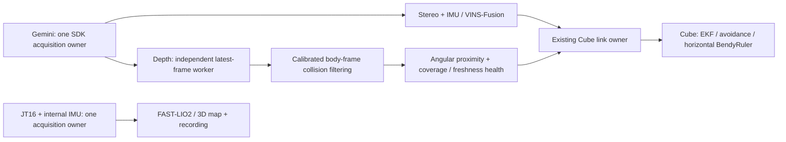

> **Project end goal:** Build a drone that autonomously flies a guided mission without GPS while detecting and avoiding obstacles along the way.
> This plan addresses measured-depth obstacle detection and local replanning for that mission capability. See the [shared project goal](../PROJECT_GOAL.md).

# Gemini depth obstacle detection and local replanning

Planning baseline: 20 November 2026. Status: proposed; no runtime, services,
Cube parameters, or flight commands changed by this plan.

Localization follow-up: the operator selected evaluation of joint LIVO using
JT16 + Gemini images + one IMU, with Gemini depth avoidance kept independent.
Standalone VINS and FAST-LIO remain comparison baselines during that evaluation.
See the [previous-flight replay audit](../reports/livo-replay-readiness-20261120/review.md).
The independent-estimator diagram below describes the initial integration
baseline, not a requirement to retain separate estimators after LIVO validation.

## Selected responsibilities

- Gemini stereo/IMU: retain the existing VINS-Fusion localization pipeline.
- Gemini measured depth: sole planned obstacle source for navigation.
- Cube: stabilization, position control, reactive avoidance and initially
  horizontal BendyRuler local detours toward a goal.
- JT16 and its built-in IMU: independent FAST-LIO2 3D mapping/recording only.
  No JT16 proximity publication or map-to-planner input in the target design.

Prefer this incremental architecture for the existing Jetson/Cube system:
use SDK depth, native C++ filtering, and the existing serial owner. Avoid
duplicating stereo matching on the Jetson, requiring dense reconstruction for
stopping, or introducing another flight controller. BendyRuler is local
obstacle detouring, not a globally complete route planner.

## Findings from the workspace

- `tools/vins_fusion/live.cpp` owns the Gemini through Orbbec SDK, requests
  left/right Y8 at 30 Hz, and currently has no enabled depth stream. Extend
  that acquisition path rather than starting a second camera process.
- Its frameset aggregation currently requires every enabled stream. Adding
  depth to that requirement could stall VINS when depth is absent. Preserve
  stereo pairing and IMU delivery with independent depth readiness; regression
  test missing-depth behavior before adopting a revised aggregation mode.
- `docs/flight-shadow-test.md` describes a shared JT16 acquisition feed on
  loopback 18777 and a separate mapper. Keep that feed while removing only
  LiDAR-derived navigation output during eventual cutover.
- The other checkout's `config/system.yaml` currently selects depth disabled,
  LiDAR enabled, and an older camera path. Its camera calibration and depth
  settings must not be treated as Gemini calibration. Its saved 0.45 s stale
  threshold was designed for approximately 5 Hz JT16, not this new stream.
- Historical reports contain multiple EKF profiles and proximity backend
  changes. They are not a live readback. Re-read firmware, parameters, active
  sources, link ownership and flight-mode support before integration.

## Depth processing and transport

1. Enumerate supported simultaneous depth/stereo/IMU profiles on the attached
   Gemini and pinned SDK. Trial depth 640 x 400 at 30 Hz if advertised with
   the existing streams; retain existing VINS settings. Measure USB load,
   stereo gaps and emitter/exposure effects on VINS features.
2. Read depth scale, actual intrinsics/distortion and camera transforms from
   the SDK. Convert depth to metres using its scale, not an assumed mm unit.
   Use depth-camera geometry, not rectified IR intrinsics by accident. Validate
   hardware timestamps against host monotonic arrival time and frame indices.
3. Process depth in a bounded latest-only worker independent of VINS solve
   time and disk I/O. Preserve full capture timestamps; never re-stamp old
   data as a new observation. Camera callbacks only hand off frame ownership.
4. Reject invalid depth; retain unknown regions. Back-project sampled pixels,
   transform into body FRD using measured mounting extrinsics, and select the
   vehicle's collision envelope. Account for roll/pitch and attitude timing
   when excluding ground. Avoid a thin center image row or unverified plane
   removal that could hide low obstacles. Mask the airframe explicitly.
5. Aggregate nearest supported returns into angular sectors. Use conservative
   spatial support to suppress isolated speckle, retaining thin-pole detection;
   do not blindly copy a 10th percentile or a multi-frame averaging window.
   New close obstacles must take effect immediately; clearing may use bounded
   hysteresis. Track valid coverage and confidence separately from distance.
6. Trial MAVLink2 OBSTACLE_DISTANCE via the existing Cube link owner. Use
   BODY_FRD, centimetres, explicit angles and 72 bins at 5 degrees. Only
   observed sectors receive measurements. Unknown/not-used is UINT16_MAX;
   max_distance+1 means observed clear, never invalid depth or outside FOV.
   Verify exact firmware interpretation, sector compression, expiry and
   replacement of old observations. Retain a compatible DISTANCE_SENSOR
   adapter only if the receiver audit requires it; do not publish both paths
   into the same proximity instance without a defined reason.
7. Keep one serial writer. Budget proximity plus odometry plus telemetry at
   the actual link baud rate; monitor queue age. A depth sender at 15 Hz must
   not turn into 15 repeated observations of a stalled camera frame.

## Trial configuration and performance gates

These are engineering targets for bench evaluation, not flight settings.

| Item | Starting proposal | Qualification |
| --- | --- | --- |
| Depth input | Supported 640 x 400, 30 Hz | Verify simultaneous profiles and near-range limits |
| Depth worker | 20-30 Hz; precomputed ray lookup | Benchmark at the actual Jetson power mode |
| Proximity output | 15 Hz, fresh observations only | Verify link utilization and receiver consumption |
| Detection range | Initially characterize 0.5-5 m | No claim that invalid/far pixels prove clearance |
| Sampling | Start stride 2, compare full resolution | Pole/branch tests determine acceptable sampling |
| Angular bins | 5 degrees; covered FOV only | Validate left/right orientation and edge coverage |
| Depth age | Trial 150 ms maximum usable age | Independent of current VINS timing policy |
| Sensor-to-write age | Target p95 <100 ms, p99 <150 ms | Log maximum age, drops and failure actions too |
| Initial motion | Forward, fixed altitude, low speed | Speed chosen only after braking/latency tests |

Use the measured condition
`verified_free_distance >= v * worst_case_delay + v^2 / (2*a_brake) + margin`.
The margin includes vehicle extent from the distance reference, calibration,
depth error, pose/attitude error and tracking error. Avoid double counting the
aircraft radius if data were already inflated. An age-limit violation inhibits
autonomous progress; missing input must not simply expire into clear space.

## Replanning and camera coverage

Start with reactive stopping, then horizontal BendyRuler in a verified
position-controlled mode and supported goal-command path. ArduPilot documents
BendyRuler for AUTO, GUIDED and RTL; do not assume arbitrary Guided velocity
commands pass through it, or that AltHold/FlowHold avoidance exists in the
installed firmware. Audit actual firmware/build before choosing parameters.

The Gemini's nominal depth FOV is about 90 x 65 degrees and depends on stream
profile and range. This is forward coverage, not all-around protection.
Marking side/rear bins unknown does not prove the Cube planner treats them as
forbidden. BendyRuler's obstacle database is not a free-space coverage map.

Before autonomous detours, demonstrate that the complete swept aircraft volume
stays in recently observed free space. Use stop, yaw to inspect, then advance
where needed; never reverse or slide sideways into unseen space. The turn
itself also sweeps the airframe and must be checked. First validate this policy
in simulation and shadow outputs. If the Cube route cannot enforce it, do not
enable autonomous BendyRuler detours with a forward-only camera.

The fallback for that failed gate is a native C++ depth-only rolling local
occupancy grid with occupied/free/unknown states and age, inflated for the
aircraft, plus local A* route selection and a bounded trajectory follower.
Use VINS poses at capture time, clear/rebuild after estimator resets, and treat
unknown as blocked. Start with fixed-altitude horizontal planning while
checking the full vertical envelope; add 3D voxel search only if over/under
detours are an explicit requirement. Benchmark a 10 x 10 x 4 m local grid at
0.15-0.20 m resolution as a proposal. This costs more integration than the
Cube path but supplies explicit coverage constraints. Keep Cube stabilization
and one command authority. JT16 remains mapping-only in either option.

## Work packages and completion evidence

1. **Read-only audit and profile feasibility:** inventory active owners,
   firmware/features, parameters, Gemini profiles, mounting and aircraft
   dimensions; define stop/inspection behavior and coordinate/time contracts.
   Deliver an evidence report and proposed configuration/rollback diff.
2. **Capture and offline replay:** add opt-in depth capture in the existing
   owner with independent readiness, bounded recording, timestamps and SDK
   calibration. Deliver replayable depth/stereo/IMU and before/after VINS
   timing/feature metrics. No navigation output.
3. **C++ detector in shadow mode:** implement projection, filtering, coverage,
   sectors and health logging. Deliver distance overlays and tests for known
   target distances/directions, thin poles, ground, tilt, invalid depth,
   sunlight, glass/dark objects, frame stalls and unplug/reconnect. Compare
   against manually measured targets; JT16 may be a diagnostic reference only.
4. **Transport and firmware simulation:** test encoding through a mock owner,
   then exact-version SITL/relevant firmware paths and props-off Cube reception.
   Demonstrate stale/unknown handling, source selection, obstacle expiry,
   braking, detours and no entry into unobserved space. Do not infer safe
   motion from a healthy PRX status alone.
5. **Mapping-only JT16 cutover:** prepare explicit source arbitration and
   rollback. Preserve JT16 reader/full mapping feed/raw recording/arm cues,
   suppress JT16 obstacle publication, and enable only Gemini proximity.
   Camera loss inhibits avoidance-dependent autonomous motion; it does not
   silently restore JT16 as an obstacle source. Map failure cannot block the
   depth loop. Verify independence and single-writer ownership.
6. **Combined load and controlled motion qualification:** run depth + VINS +
   Cube transport + JT16 mapping at 15 W for sustained thermal load. Record
   p95/p99/max latency, VINS gaps, CPU/RAM/temperature, coverage and fault
   response. Verify localization health/fusion and mode-specific behavior;
   depth loss and localization loss need distinct responses because position
   hold may be unavailable after localization loss. Validate measured stopping
   first, then simple horizontal detours, blocked corridors and moving targets.

First implementation increment: work packages 1-3, ending with a replayable,
measured Gemini-only detector in shadow mode. Activation is a later increment
after the exact receiver and coverage constraints have been demonstrated.

## Sources

- [Orbbec Gemini 336L](https://www.orbbec.com/products/stereo-vision-camera/gemini-336l/)
- [Orbbec SDK v2](https://github.com/orbbec/OrbbecSDK_v2), retain workspace-pinned SDK initially
- [MAVLink OBSTACLE_DISTANCE](https://mavlink.io/en/messages/common.html#OBSTACLE_DISTANCE)
- [ArduPilot BendyRuler](https://ardupilot.org/copter/docs/common-oa-bendyruler.html)
- [ArduPilot avoidance implementation overview](https://ardupilot.org/dev/docs/code-overview-object-avoidance.html)
- Local: `tools/vins_fusion/live.cpp`, `docs/flight-shadow-test.md`,
  `docs/jt16-only-mapping.md`, and inspected external checkout
  `/home/atas/vscode/optFlow_slam/config/system.yaml`.
