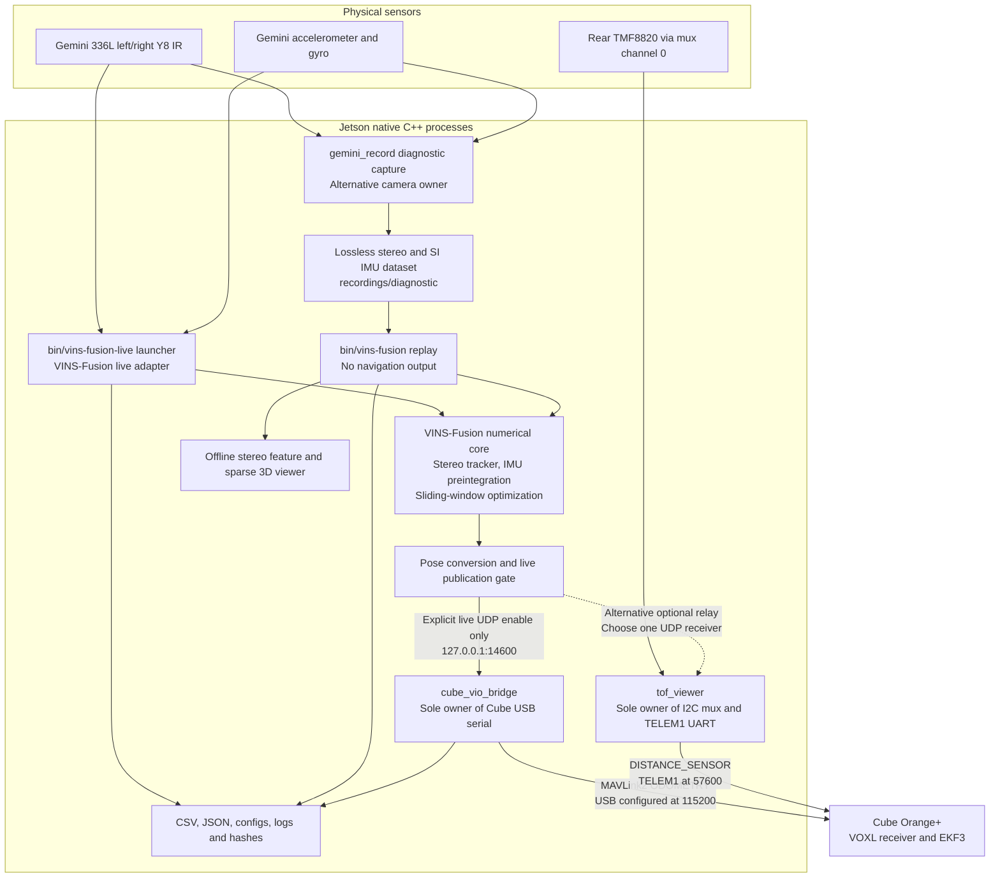
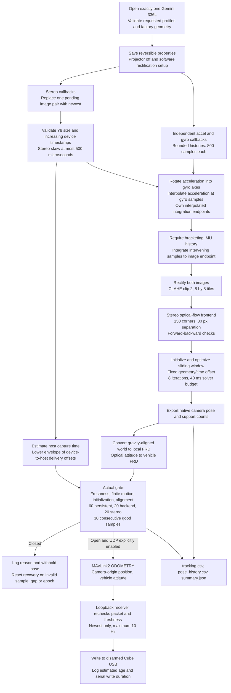

> **Project end goal:** Build a drone that autonomously flies a guided mission without GPS while detecting and avoiding obstacles along the way.
> These operator procedures document intermediate localization, transport and visualization tests toward that goal. See the [shared project goal](../PROJECT_GOAL.md).

# VINS-Fusion operator testing and configuration guide

**Baseline date: 28 October 2026 (IST).** Workspace: `/home/atas/BHUslamV3`.

VINS-Fusion stereo + IMU is the primary program in this guide. It runs native
C++ on the Jetson with a Gemini 336L, without a ROS runtime. This document is a
shared reference for operators collecting datasets, comparing processing rates,
checking live output and testing the disarmed Cube transport.

## 1. Current status and evidence

| Area | Current documented state | Evidence / qualification |
| --- | --- | --- |
| Primary estimator | VINS-Fusion stereo + IMU, pinned core `be55a937a57436548ddfb1bd324bc1e9a9e828e0` | Native adapters in `tools/vins_fusion`; official numerical core unchanged |
| Live default | Mild CLAHE, four OpenCV threads through `bin/vins-fusion-live` | [Rate/gate review](../reports/fusion-rate-gate-20261028/review.md) |
| Jetson power | Mode 0, `15W`, read during this documentation pass | Recheck before each run; mode is not whole-system battery consumption |
| Boot selection | `bhu-vio-record.service` enabled, inactive at inspection; `bhu-cube-vio-test.service` disabled, inactive | Live service-state inspection on baseline date; standalone `bhu-vio-test.service` not installed |
| Cube receiver | VISO backend and source set 2 configured in last saved inspection | [28 October Cube inspection](../reports/cube-extnav-status-20261028.md); no new hardware parameter readback performed for this guide |
| Live Cube transport | 67 producer publications, 53 host USB writes in a prior 60 s motion run | [Live latency review](../reports/fusion-live-15w-20261028/review.md); output intermittent |
| EKF fusion | Not demonstrated; active source set not established by the saved inspection | Earlier run reported uninitialized EKF / waiting for GPS configuration |
| Calibration | Factory geometry used; noise, time offset, mount and delivery clock mapping provisional | `Calibration.imuValidated: 0` |
| Loop closure | Off in the VINS-Fusion adapters | Sparse viewer is local odometry geometry, not a globally optimized map |

**Operating scope: disarmed bench testing.** Initialization, a plotted route,
a gate-open count or a host serial write does not establish pose accuracy or
Cube EKF acceptance. No ground-truth trajectory is available.

Historical guides can describe an earlier stage. In particular, the older
Cube status report's statement that VINS-Fusion has no live publisher has been
superseded by the live implementation and latency/rate reports linked above.
The old `orb.yaml` calibration filename does not select ORB-SLAM3.

## 2. Architecture and ownership



The live and recording boxes are alternative camera owners, not simultaneous
capture paths. Replay/viewer processes read saved datasets. For performance
comparisons, run these sequentially even when they do not share devices.

| Resource | Owner / rule |
| --- | --- |
| Gemini USB camera | One live adapter, recorder, preview or inspector at a time |
| Cube USB serial | `cube_vio_bridge` during live transport; close GCS/other tools using that same port |
| `/dev/ttyTHS1` | Native ToF viewer/bridge only; this is a separate physical Cube link |
| `/dev/i2c-7`, mux `0x70` | One ToF process; rear sensor selected on channel 0 |
| UDP 14600 | One odometry receiver: USB bridge or optional ToF UART relay |
| UDP 14601 | Cube feedback channel used by recording/legacy QR workflow |
| Loopback HTTP 8765 | ToF dashboard; closing its tab does not stop capture |
| Output directory | Unique per run; tools reject existing result directories |

Main code references: [live adapter](../tools/vins_fusion/live.cpp),
[replay adapter](../tools/vins_fusion/main.cpp),
[shared estimator defaults](../tools/vins_fusion/runtime_globals.hpp),
[camera helpers](../include/bhu/camera.hpp),
[IMU interpolation](../include/bhu/imu.hpp),
[navigation gate](../include/bhu/external_nav.hpp),
[relay](../include/bhu/extnav_relay.hpp), and
[Cube USB bridge](../src/cube_vio_bridge.cpp).

## 3. Detailed live processing pipeline



Video overwrites are intentional newest-frame selection and are distinct from
USB acquisition losses. All intervening usable IMU samples are integrated.
Insufficient bracketing history may skip an image; invalid/nonmonotonic IMU or
excessive gaps stop the test. Device timestamps drive integration, not host
arrival or publication timestamps.

Optical axes are right/down/forward; body FRD is forward/right/down. The mount
maps `[x,y,z]optical` to `[z,x,y]body`. Published pose frame is
`MAV_FRAME_LOCAL_FRD`, twist frame is `MAV_FRAME_BODY_FRD`, and quaternion order
is **w,x,y,z**. Local yaw is arbitrary and requires Cube heading alignment.
Position stays at the camera origin; the Cube applies the 0.15 m lever arm
once. Live axis signs and lever-arm behavior still require measurement.
Covariance is unknown (NaN), not zero.

## 4. Settings operators should record

### Camera and geometry

Source: [camera YAML](../configs/gemini336l-CPC2963000JJ-fast.yaml) and
[mount YAML](../configs/cube-extnav-bench.yaml).

| Setting | Current value / interpretation |
| --- | --- |
| Camera | Gemini 336L, serial `CPC2963000JJ`; recorded firmware 1.8.10, SDK 2.10.6 |
| Stereo stream | 640 × 400, Y8 left/right, nominal 30 FPS |
| IMU request | Nominal 200 Hz; accelerometer ±4 g, gyro ±1000 degrees/s |
| Rectified intrinsics | fx = fy = 308.16494751 px; cx = 317.25 px; cy = 201 px |
| Stereo baseline | 0.0947195968628 m; right centre lies along left-camera +X |
| Left camera into gyro/body | Rotation identity in saved rectified transform; translation `[-0.0078860001564, -0.00108599996567, 0.014248000145]` m |
| Vehicle mount assumption | Forward facing, upright; left optical centre `[0.15, 0, 0]` m in vehicle FRD |
| Projector | Off while capturing; reversible settings restored on normal cleanup |
| Exposure | Existing device setting; no new exposure policy prescribed |
| IMU units | Acceleration m/s², gyro rad/s; gravity retained |
| Time convention | Device microseconds converted to seconds; factory translations mm → m |
| Stereo skew limit | 500 µs |
| IMU gap rejection | More than 20 ms in synchronized input |

A forced kill/power loss cannot run property restoration. Reinspect after
abnormal termination. The adapter checks connected profile geometry against
its YAML; do not transplant these calibration numbers to another camera.

### Estimator, timing and publication

| Setting | Current default |
| --- | --- |
| OpenCV workers | Launcher: 4; direct native binary baseline: 1; override with `--opencv-threads N` |
| Live enhancement | CLAHE clip 2, 8 × 8 tiles; `--clahe-clip 0` disables it in live mode |
| Replay enhancement | Off unless requested; use `--clahe-clip 2` to match mild enhancement; replay requires a positive clip value |
| Stereo frontend | Max 150 corners, min separation 30 px, forward/backward flow check enabled |
| Optimization | 10-state sliding window; max 8 iterations; 0.04 s solver budget |
| Online calibration | Extrinsic and temporal estimation off |
| Time offset | YAML `IMU.TimeOffsetSeconds=0`; VINS `td=-offset`; unmeasured |
| YAML noise / walks | Gyro 0.001, acceleration 0.01; gyro walk 0.000001, acceleration walk 0.0001; provisional |
| VINS noise conversion | Each YAML noise/walk × √200: acc_n ≈ 0.141421, gyr_n ≈ 0.0141421, acc_w ≈ 0.00141421, gyr_w ≈ 0.0000141421 |
| Alternative noise experiment | Replay `--native-noise`: upstream EuRoC values; not Gemini calibration |
| Calibration flag | `Calibration.imuValidated=0`; bench live runs require `--allow-provisional` |
| Loop closure | Disabled |
| Actual visual support gate | ≥40 persistent frontend features, ≥20 backend tracks, ≥20 stereo matches |
| Recovery | 0.5 s of continuous good capture timestamps, plus shared validity/alignment guards |
| Freshness / gap | 150 ms; future/stale/duplicate timestamps and resets interrupt eligibility |
| Velocity check | Provisional finite-difference sanity ceiling 10 m/s |
| Quality minimum | Fusion relay and Cube: 40; feature-count heuristic, not measured uncertainty |
| Relay | Newest eligible packet, up to 10 Hz; no repeating old poses |
| Navigation default | Dry run; UDP requires explicit `--udp-port` or latency launcher `--cube` |

Upstream failure detection is disabled in this pinned VINS revision. An
initialized solver alone therefore cannot certify visual tracking. The logged
time-based shadow gates (60 features / 0.5 s recovery and 40 features / 0.5 s)
**never publish**. The current live source also logs
`shadow_frame15_feature40` (40 persistent features, 15 consecutive samples);
it is diagnostic only and is not part of the published rate comparison above.
The 0.5 s / 40-feature policy is now the active publication gate; its separately
logged shadow is a consistency check. Other candidate gates remain diagnostic.

### Cube and optional rangefinder

Latest quality alignment: [verified single-parameter update](../reports/fusion-downstream-align-20261028/review.md). Other Cube configuration: [configuration status](../reports/cube-extnav-status-20261028.md).

| Parameter / link | Last verified value |
| --- | --- |
| Firmware | ArduCopter 4.7.1, hash `dbe79216`, Cube system 1/component 1 |
| `VISO_TYPE`, `VISO_ORIENT` | 3 (VOXL-compatible receiver), 0 (software corrects optical orientation) |
| `VISO_POS_X/Y/Z`, `VISO_QUAL_MIN` | 0.15 / 0 / 0 m, minimum quality 40 |
| `EK3_SRC2_POSXY` | 6, ExternalNav |
| `EK3_SRC2_VELXY/VELZ` | 0 / 0, velocity fusion disabled |
| `EK3_SRC2_POSZ`, `EK3_SRC2_YAW` | 1 / 1, barometer / compass |
| Active source set | Not established by saved inspection; launchers do not select it |
| Cube USB | `/dev/serial/by-id/usb-CubePilot_CubeOrange+_36003F000B51333338373339-if00`, configured baud 115200 |
| ToF TELEM1 | `/dev/ttyTHS1`, 57600; `SERIAL1_PROTOCOL=2`, `SERIAL1_BAUD=57` |
| Rear rangefinder | `RNGFND2_TYPE=10`, `ORIENT=4`, `MIN=0.01`, `MAX=5.0` m; max is advertised, not validated range |
| Proximity | `PRX1_TYPE=0`; rangefinder-only scope |

The older `cube-extnav-proposed.param` and guides showing `VISO_TYPE=0`,
TELEM2/115200 or proximity enabled describe earlier stages. Do not use them as
a restore baseline. Obtain a fresh read-only snapshot if configuration is in
doubt; use per-change backups for restoration.

## 5. Operator preparation and handoff

1. Name one operator as hardware owner and another as observer/logger. Record
   the owner before starting; other operators do not launch device tools.
2. Keep Cube disarmed with propellers removed for these bench procedures.
   Confirm camera mounting, unobstructed optics, common power and connections.
3. Check boot services before opening the camera or Cube USB. An enabled but
   inactive recorder can start again on the next boot.
4. Use the same route, lighting, textured scene, power mode and starting thermal
   conditions for comparisons. Avoid concurrent builds/replays and vary one
   setting at a time. Record explicit thread/CLAHE flags.
5. Allocate a new output path. Allow about 3.7 GB plus reserve for a two-minute
   diagnostic dataset; inspect free space before capture.

From a terminal:

```bash
cd /home/atas/BHUslamV3
source scripts/env.sh
bin/vio-test power-info
systemctl --user is-enabled bhu-vio-record.service bhu-cube-vio-test.service
systemctl --user is-active bhu-vio-record.service bhu-cube-vio-test.service
df -h .
```

If a project capture service is active, its owner stops it cleanly before a
foreground test, then waits for data finalization:

```bash
systemctl --user stop bhu-vio-record.service bhu-cube-vio-test.service
```

`bin/vio-test power-15w` explicitly changes the power policy if needed; honor
any reboot request. `scripts/env.sh` selects the staged ARM64 CMake because
this host's `/usr/local/bin/cmake` is an x86 binary.

Build/check after source changes, before timing runs:

```bash
bash scripts/build-vins-fusion.sh
cmake --build build/main --target cube_vio_bridge --parallel 1
ctest --test-dir build/vins-fusion --output-on-failure
ctest --test-dir build/main --output-on-failure
```

The main build must already have been configured/built with
`bash scripts/build.sh` on a fresh setup. Native transport fixtures use
loopback sockets and pseudo-terminals, not flight hardware. Record test exit
codes; socket permission failures are an environment problem to resolve.

## 6. Repeatable VINS-Fusion test methods

Replace every `NEW-*` path and `RECORDING` placeholder before use. Commands below
are alternatives to run sequentially, not one batch to paste and run together.

### A. Live capture/estimator dry run

```bash
scripts/run-vins-fusion-latency.sh reports/NEW-fusion-dry 20
```

This verifies 15 W, collects available tegrastats and runs the current live
launcher without Cube navigation. For explicit rate/contrast control:

```bash
bin/vins-fusion-live configs/gemini336l-CPC2963000JJ-fast.yaml \
  configs/cube-extnav-bench.yaml reports/NEW-fusion-rate \
  --seconds 20 --opencv-threads 4 --clahe-clip 2 --allow-provisional
```

Run an initial stationary check, then a separate moving check with smooth
translation and gentle rotation through a textured scene. Test startup,
initialization, age, support counts and clean exit. Zero publications is
expected without UDP; distinguish gate eligibility from transmitted count.
No raw image dataset is retained by this live workflow.

### B. Collect reusable input for Fusion

```bash
bin/vio-test cube-record --seconds 120
```

This is a capture utility, not an ORB/VINS estimator test. It requires the
camera and disarmed Cube USB for audible feedback, records immediately without
QR, and uses a feedback-only bridge with no odometry input. Three beeps mark
start; three after completion mark saved/synced data. Six rapid low notes mean
an error. The final cue does not shut Linux down.

Use separate stationary and moving recordings. For the moving sequence,
translate in several directions and include a repeatable outdoor/indoor or
texture transition only where suitable. Record known distances and stationary
pauses if possible; avoid claiming surveyed ground truth from an informal path.

```bash
bin/vio-test record-check recordings/diagnostic/RECORDING
bin/bhu imu-stationary recordings/diagnostic/STATIONARY_RECORDING reports/NEW-imu-check
```

Inspect completion, timestamp monotonicity, stereo skew, image existence,
frame/IMU gaps and gravity statistics before replay. A successful integrity
check says the dataset is usable, not that VIO succeeded. Cube capture bridge
summaries should show `navigation_enabled=false`, `odometry_forwarded=0`.
[Full recording format](vio-diagnostic-recording.md).

### C. Recorded-input estimator and rate comparisons

Ordinary replay processes all selected source images; it measures offline
processing cost rather than live latency:

```bash
bin/vins-fusion recordings/diagnostic/RECORDING reports/NEW-fusion-replay \
  --opencv-threads 4 --clahe-clip 2
```

For rate-sensitive newest-frame simulation:

```bash
bin/vins-fusion recordings/diagnostic/RECORDING reports/NEW-fusion-paced-t4 \
  --opencv-threads 4 --clahe-clip 2 --realtime-latest --preload-images
```

Repeat sequentially with 1, 2 and 4 threads using distinct outputs and the same
source. Preload removes disk stalls from the timing interval, checks a 512 MiB
memory reserve and can use about 1.84 GB for the reference two-minute source.
That cache is benchmark-only memory. Paced mode requires an explicit thread
count and rejects `--viewer`. Compare processed/skipped source counts, source
indices, age percentiles, gate coverage and longest outages. Verify
`imu_endpoint_owned: true` in corrected replay summaries; exclude older
pre-fix results from numerical comparisons.

`playback_age_ms` is synthetic age since scheduled source availability. It
excludes real camera exposure/USB and live rectification. Offline replay has
no navigation output. [Rate and gate details](vins-fusion-rate-gates.md).

### D. Inspect stereo support and sparse geometry

```bash
build/vins-fusion/bin/fusion_image_quality recordings/diagnostic/RECORDING \
  reports/NEW-image-check --samples 60
bin/vins-fusion recordings/diagnostic/RECORDING reports/NEW-fusion-view \
  --opencv-threads 4 --clahe-clip 2 --viewer
```

Open the generated `viewer.html`; retain `viewer-images/` alongside it when
sharing. Compare stereo matches, persistent tracks, image brightness/coverage,
and pose behavior at weak transitions. Image snapshots and the viewer's
support colors are diagnostic heuristics. Export encoding affects runtime,
so keep viewer runs separate from rate measurements. Landmarks form a sparse
local sliding-window/history view; drift and revisits can duplicate surfaces.
[Viewer controls](vins-fusion-viewer.md), [image diagnostics](image-quality-gate-check.md).

### E. Disarmed live Cube transport

Complete dry-run checks and release Cube USB before this test:

```bash
bin/vio-test cube-config
scripts/run-vins-fusion-latency.sh reports/NEW-fusion-cube 60 --cube
```

`cube-config` without `--apply` reads receiver settings and saves a local
snapshot. The latency launcher starts the sole USB bridge, waits for readiness,
enables live UDP, and stops capture if the bridge exits. It neither switches
EKF sources nor changes Cube parameters or arming state.

Compare producer eligibility/publications with bridge forwards/rejections and
link health. Inspect `bridge/events.jsonl`, `bridge/summary.json`, Cube status
text and `cube.tlog`. Record age at serial write as well as producer age.
The 10 Hz relay may introduce waiting or expire a pose. Serial write duration
measures a host call, not Cube receipt or fusion delay. Do not classify every
rejection as network loss; existing summaries do not classify all reasons.

A separate integration validation must establish known EKF origin, mount/axis
signs, heading/lever-arm response, receiver health, innovations and actual
source selection before claiming fusion. Source switching and parameter
application are outside this routine test procedure.

### F. Occlusion and recovery investigation

After a nominal dry run, perform a separately labelled dry test with brief,
controlled texture loss/occlusion followed by return to the same textured
scene. Log approximate event times. Inspect gate closure, reset epochs,
recovery duration, withheld poses and longest output gaps. A desired behavior
is to withhold invalid/stale output and recover only through the configured
gate. This is a proposed repeatable robustness test, not a claim that it has
already passed. Keep timed shadow candidates diagnostic; do not lower the
actual thresholds to obtain a larger packet count.

### G. Visualization tools and sharing results

Use the stereo/3D recording viewer as the primary Fusion visualization. It
replays saved exports; the live Fusion adapter currently logs CSV/JSON and
does not serve the older ORB live dashboard on port 8766.

| Tool | What operators can inspect | Open / output |
| --- | --- | --- |
| Fusion stereo + sparse 3D viewer | Synchronized left/right images, feature IDs and trails, stereo matches, trajectory, active landmarks and accumulated history | Exported `viewer.html`; [existing recording selector](../reports/vins-fusion-viewer/index.html) |
| First-person / behind-camera mode | Sparse scene from 0.8 m behind the camera, following translation, orientation and roll | Toggle inside the Fusion viewer; wheel adjusts perspective zoom |
| Image quality diagnostics | Sampled stereo overlays, spatial corner coverage, stereo consistency and original versus CLAHE statistics | `contact-sheet.jpg`, `stereo-*.jpg`, `samples.json`, `summary.json` |
| Native static viewer preview | One image combining stereo observations and sparse trajectory/landmarks at a chosen elapsed time | `viewer-preview.png` inside an existing export |
| Saved moving-image A/B page | Side-by-side entry points for original/contrast-enhanced recorded tests | [moving-image comparison](../reports/fusion-moving-image-gate-20261028/index.html) |
| Historical estimator comparison | Independent local trajectories, availability and processing metrics; Fusion alongside brief Mono/ORB baselines | [saved benchmark report](../reports/vins-fusion-benchmark-20261026/comparison/comparison.html) |

**Create a Fusion viewer export matching the current mild contrast profile:**

```bash
bin/vins-fusion recordings/diagnostic/RECORDING reports/NEW-fusion-visual \
  --opencv-threads 4 --clahe-clip 2 --viewer --viewer-stride 3
```

Open `reports/NEW-fusion-visual/viewer.html` in a browser after completion.
Alternatively, `bin/vins-fusion-viewer RECORDING NEW_OUTPUT --clahe-clip 2`
is a convenience wrapper with one OpenCV thread; record this difference when
comparing results. It does not inherit the four-thread live-launcher default.
Default stride 3 exports about 10 display frames/s from a nominal 30 FPS source
while processing every input pair. Use `--viewer-stride 1` for every processed
frame; it increases export size. `--max-frames N` bounds a preview run.

**Playback and inspection controls:**

- Space toggles play/pause; arrow keys step frames. Use scrub and speed controls
  to inspect the same transition repeatedly.
- Drag to orbit, wheel to zoom and shift-drag to pan. Fit current map, whole
  route, top view and follow camera provide different inspection viewpoints.
- Enable stereo match lines/IDs and click a feature to highlight its solved
  landmark when one exists. Green left points are persistent tracks, yellow
  points are new tracks, and blue points are right-eye matches.
- First-person mode follows full camera orientation; turn it off to return to
  orbit/pan. Before initialization, perspective waits for a usable pose.
- Inspect epochs separately. Viewer initialization/support colors are distinct
  from the stricter live publication gate; amber means diagnostic weak support.

**Generate a static preview and an image contact sheet:**

```bash
# Time is elapsed seconds within an already generated viewer export.
build/vins-fusion/bin/fusion_viewer_preview reports/NEW-fusion-visual 40
build/vins-fusion/bin/fusion_image_quality recordings/diagnostic/RECORDING \
  reports/NEW-fusion-images --samples 60
```

The preview selects the last exported frame at or before the requested time.
Open `viewer-preview.png` and `reports/NEW-fusion-images/contact-sheet.jpg`.
JSON measurements use lossless source images; JPEGs are inspection aids.
To update an existing viewer's UI template without rerunning estimation, use
`fusion_viewer_preview EXPORT 40 --refresh-viewer`; it rewrites `viewer.html`
from that export's existing data and produces the preview.

**Sharing and interpretation:** copy the whole viewer export directory,
including `viewer.html`, `viewer-data.json`, `viewer-images/`, separate-epoch
PLY point clouds and config/summary files. HTML playback needs no server,
internet, camera or Cube connection and has a software-rendering fallback.
The folder picker expects an exported viewer folder, not a raw recording.
PLY history is sparse local geometry without loop closure; duplicated surfaces
and drift do not represent a dense reconstruction. Existing exported routes
retain their original settings and are not rerun by opening the HTML.

Keep visualization exports out of paced rate tests: `--realtime-latest` rejects
`--viewer`, and image encoding/geometry export changes timing and memory use.
The older benchmark comparison is a historical visual reference; earlier
recorded numerical runs must be interpreted with the IMU endpoint issue noted
in section 6C. Use corrected runs for new conclusions. Full viewer details:
[controls and export conventions](vins-fusion-viewer.md).

## 7. How to read results

| Artifact / metric | Interpretation |
| --- | --- |
| `camera.yaml`, `navigation.yaml`, `vins-config.yaml`, `stereo-extrinsics.yaml` | Effective calibration/mount/estimator settings saved by live runs |
| `tracking.csv` | Per-frame stages, support, gate decisions, age and overwritten images |
| `pose_history.csv` | Native camera poses, including initialized poses withheld from publication |
| `summary.json` | Counts and timing; field names differ between live and replay |
| `bridge/events.jsonl` | Link/cue events, forwarding and host serial-write timing |
| `bridge/cube.tlog` | Inbound Cube telemetry; timestamps are host monotonic µs, not UTC |
| `tegrastats.log`, power readbacks | Module resource context; not total battery/peripheral power |
| `binaries.sha256`, console logs | Executable identity and exact behavior/errors |
| Recording `recording-check.json` | Input integrity/completion checks, independent of estimator accuracy |

Evaluate each layer separately: (1) dataset integrity, (2) initialization and
visual support, (3) fresh eligible pose continuity, (4) transport/link health,
(5) Cube fusion and physical accuracy. Mark untested layers explicitly.
There is no validated universal accuracy/pass threshold yet. Report coverage
with its denominator: initialized processed samples, all processed samples,
source frames or elapsed time. Frame coverage and time availability differ.

Reference results, not acceptance guarantees:

| Test | Observed result | Limitation |
| --- | --- | --- |
| Latest 20 s live, 4 OpenCV threads | 19.4 processed FPS; estimated age median/p95 66.9/94.3 ms; actual gate 316/380 initialized samples | Short stationary scene, UDP disabled |
| Corrected paced two-minute input, 4 threads | 17.9 processed FPS; synthetic age median/p95 70.9/106.1 ms; actual gate 40.5% | Weak transition still had about 19.91 s longest actual-gate gap |
| Earlier 60 s live motion + USB | 67 publications, 53 forwards; write-age median/p95 117.60/141.82 ms | Earlier profile; intermittent output; Cube EKF fusion not shown |

Sources: [latest rate comparison](../reports/fusion-rate-gate-20261028/review.md),
[earlier live transport](../reports/fusion-live-15w-20261028/review.md).
Exposure/USB latency is not independently measured in the delivery-based age
mapping. A rejected over-150-ms sample does not change the freshness limit.

## 8. Troubleshooting and stopping

| Symptom | Operator action |
| --- | --- |
| Camera busy / profile mismatch | Identify current camera owner; stop it cleanly; inspect profile/calibration match |
| USB access denied after reconnect | Check device permissions and installed narrow Gemini udev rule; use `bin/vio-test install-usb-rule` only when installation is needed |
| Initialized but gate remains closed | Inspect persistent/backend/stereo counts, age and warmup resets; use saved-image diagnostics; keep thresholds unchanged |
| Low throughput / increasing age | Verify 15 W, threads, thermals and competing processes; use newest-frame overwrite counters |
| IMU buffer/gap/timestamp error | Preserve failed logs; check dataset or device stream; do not extrapolate missing input |
| UDP bind fails | Release the other receiver on port 14600; USB and UART relays are alternatives |
| Bridge exits / Cube heartbeat lost | Let launcher stop capture; check Cube power, disarmed state and USB ownership |
| `VisOdom: not healthy` / EKF waiting | Inspect telemetry, fresh-pose continuity and origin/source prerequisites; host writes alone do not prove fusion |
| No usable trajectory / nonzero exit | Preserve artifacts and failure status; do not relabel visual-only or initialized-only output as success |
| ToF I/O fault | Use verified bus 7, mux channel 0 and serial-matched calibration; stop competing mux/UART owners |

For foreground tests use Ctrl-C and wait for final logs/property cleanup.
For user services use `systemctl --user stop UNIT`. Check output completion
before handing devices to another operator. Shut Linux down normally before
removing battery power. Closing a dashboard tab does not stop its process.

## 9. Boot capture and short comparison references

The current boot task is dataset collection for subsequent Fusion replay:
`bin/vio-test boot-record` selects the 120 s recorder for the next boot and
disables the older QR VIO boot unit. It does not start recording immediately.
`systemctl --user start bhu-vio-record.service` starts one manual capture.
Disable boot capture with `systemctl --user disable --now bhu-vio-record.service`
when that is the intended handoff state. Tell the next operator which boot
mode was left enabled; VINS-Fusion live is currently a foreground bench workflow.

| Secondary tool | Brief purpose / reference |
| --- | --- |
| ORB-SLAM3 | Historical stereo/inertial and QR performance comparison, including loop-closure experiments; [performance guide](vio-performance.md). `bin/vio-test arm` / `cube-arm` run this older estimator, not Fusion |
| VINS-Mono | Historical monocular + IMU comparison; [benchmark](vins-mono-benchmark.md) |
| ToF rangefinder | Independent rear ranging; [native bridge guide](../tools/tof_bridge/README.md). Current command: `tools/tof_bridge/cpp/build/tof_viewer --mux-address 0x70 --mux-channel 0`; one sensor, rangefinder-only |

## 10. Per-run operator record

Copy this block into a new Markdown note inside the run's parent results
folder. Keep raw evidence and add interpretation separately.

```text
Run ID / local date and time / timezone:
Operator / observer / next hardware owner:
Objective and method (dry live / recorded / paced / viewer / Cube transport):
Exact command, output directory and exit status:
Source recording (if applicable), binary hashes / source revision if available:
Camera serial, firmware, mount and config copies:
Power mode before/after; temperature; background load:
Threads / CLAHE / noise policy / provisional-calibration flag:
Scene, lighting, route, known distances and disturbance event times:
Capture completion / integrity warnings:
Processed and skipped/overwritten frames / initialized samples:
Support counts / actual gate coverage and denominator / longest outage:
Age median/p95/max (live estimate or synthetic playback):
Producer publications / bridge forwards and rejections / link drops:
Cube receiver snapshot / source-selection evidence / EKF status:
Accuracy or fusion checks actually performed; untested layers:
Artifact paths, anomalies, verdict and follow-up:
Clean shutdown verified / device ownership released:
Services and boot selection left for next operator:
```

Update this guide's baseline date and evidence links when defaults or hardware
settings change. Preserve old run configs and backups so another operator can
reproduce the exact test conditions.
